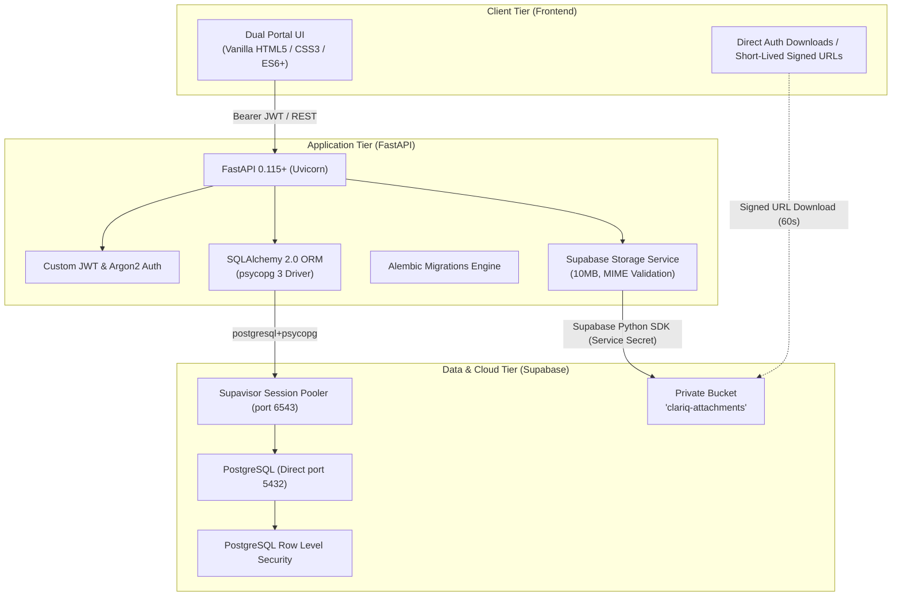

# ClariQ — Supabase Architecture Specification

**System:** ClariQ (AI-Powered, Identity-Protected Academic Doubt Resolution Platform)  
**Infrastructure Target:** Supabase PostgreSQL & Supabase Storage  

---

## 1. High-Level Architecture Overview

---

## 2. Component Specifications

### 1. Frontend
- **Technology:** Vanilla HTML5, CSS3, JavaScript (ES6+).
- **Authentication Handling:** Stores issued token in `sessionStorage.clariqToken`.
- **Contracts Preserved:** No frontend framework rewrites. All REST contracts (`/api/auth/login`, `/api/auth/me`, `/api/academic/...`, `/api/student/doubts`, `/api/student/sessions`) are preserved.

### 2. Backend Service (FastAPI)
- **Runtime:** Python 3.11 inside dedicated virtual environment (`backend-python\.venv`).
- **ORM:** SQLAlchemy 2.0 with 24 relational models.
- **Driver:** `psycopg` 3 (`postgresql+psycopg://...`).
- **Connection Management:** Connection pooling (`pool_size=10`, `max_overflow=20`, `pool_pre_ping=True`, `pool_recycle=1800`).
- **Identity Protection:** Enforces anonymous doubt flags so student identity is never serialized to teacher views.

### 3. Database Layer (Supabase PostgreSQL)
- **Hosted Project:** `https://xkxpptzhirajzjntkrlb.supabase.co`
- **Dialect:** PostgreSQL 15+.
- **Data Integrity:** Strict foreign keys, composite unique constraints, audit timestamps, and cascading behaviors.
- **Row Level Security (RLS):** Enabled across tables for defense-in-depth protection against unauthorized direct client access.

### 4. Storage Layer (Supabase Storage)
- **Bucket:** `clariq-attachments` (Private).
- **Security:** Uploads gated by backend file validation (PNG, JPG, JPEG, PDF ≤ 10 MB).
- **Access Model:** Streamed through authenticated FastAPI endpoints or via 60-second signed URLs. No public direct URLs.
